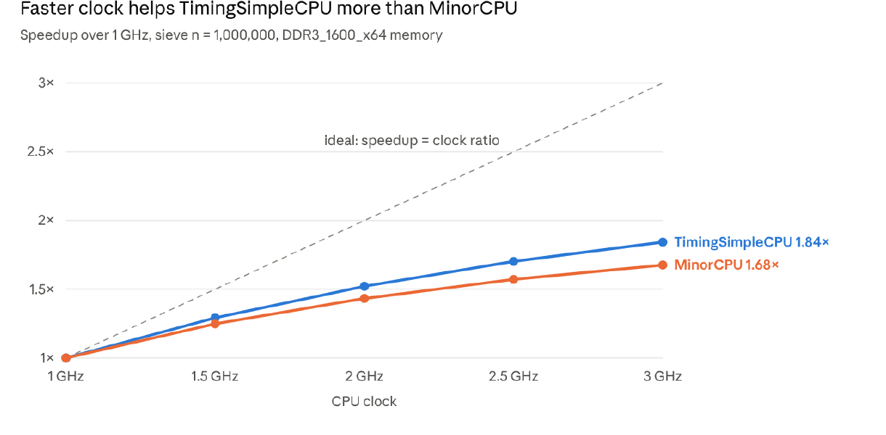
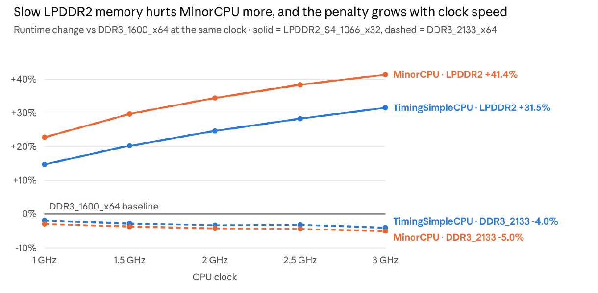

# P1: CPU Frequency vs. Memory Technology for a Prime Sieve in gem5

How much does a CPU's clock speed matter compared with its memory technology? I ran a prime sieve in gem5 across two CPU models, five clock speeds and three DRAM types, then compared the runtimes.

## What I did
- Wrote a Sieve of Eratosthenes in C ([src/sieve.c](src/sieve.c)). With n = 1,000,000 it finds 78,498 primes in 13.89 M instructions. Its 1 MB array is bigger than the 256 kB L2, so it has to go to main memory.
- Built a custom ARM system for gem5 in syscall-emulation mode ([src/sieve-config.py](src/sieve-config.py)):
  - 16 kB L1 instruction cache, 64 kB L1 data cache (both 2-way) and a 256 kB 8-way L2
  - Command-line flags: `--cpu {timing,minor}`, `--clock`, `--mem`, `--n`
- Swept every combination, 30 runs in total:

| Parameter | Values |
|---|---|
| CPU model | TimingSimpleCPU (one instruction at a time), MinorCPU (in-order pipeline) |
| CPU clock | 1, 1.5, 2, 2.5, 3 GHz |
| Memory | DDR3_1600_x64, DDR3_2133_x64, LPDDR2_S4_1066_x32 |

The assignment's memory names are `DDR3_1600_8x8`, `DDR3_2133_8x8` and `LPDDR2_S4_1066_1x32` in current gem5. The config maps one to the other.

## Findings
Full write-up: [docs/P1-report.pdf](docs/P1-report.pdf).





- **Frequency:** Tripling the clock (1 to 3 GHz) gives TimingSimpleCPU 1.84× and MinorCPU 1.68×, well short of the ideal 3×. MinorCPU is still faster in absolute terms (34.8 ms vs 55.6 ms at 3 GHz).
- **IPC falls as the clock rises**, because memory latency is fixed in nanoseconds and costs more cycles at higher clocks. TimingSimpleCPU goes from 0.136 to 0.083 and MinorCPU from 0.238 to 0.133.
- **Slow memory hurts MinorCPU more:** LPDDR2 adds 22.8–41.4% to its runtime vs 14.8–31.5% for TimingSimpleCPU. The penalty roughly doubles from 1 to 3 GHz.
- **Fast memory barely helps:** DDR3_2133 over DDR3_1600 saves only 2–5%.
- **Frequency beats memory for this program:** the clock moves runtime up to 1.84×, memory up to 1.41×. A cache-friendly program would scale closer to 3× with the clock, and a pointer-chasing one would depend mostly on memory speed.
- **Pipelining:** at 1 GHz, MinorCPU is 1.75× faster than TimingSimpleCPU (58.4 vs 102.4 ms).

## Repository layout
```
src/       sieve.c and the gem5 config
docs/      project report and charts
results/   sweep_summary.txt and the stats.txt from each of the 30 runs
```

`results/sweep_summary.txt` has one row per run. Columns are CPU, clock, memory, runtime (ms), instructions, IPC and host seconds. Per-run gem5 stats are in `results/sweep/<cpu>_<clock>_<mem>/stats.txt`.

## My setup
I built gem5 25.1 (ARM) inside an Ubuntu VM managed with Multipass on my Apple Silicon Mac, and worked in it from VS Code over Remote-SSH. Because the VM is ARM, `gcc` produces ARM binaries, so I simulated the ARM ISA rather than x86. The sieve is compiled with `-static`, which gem5's syscall-emulation mode needs.

A single run looks like:

```bash
gcc -static -O2 src/sieve.c -o sieve
gem5.opt src/sieve-config.py --cpu minor --clock 2GHz --mem DDR3_1600_x64
```
